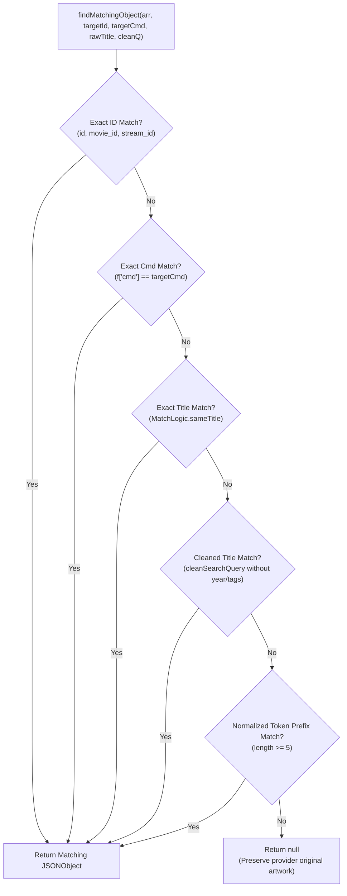

# INFINITY ONE: Low-Level Design (LLD)

This document provides a low-level architectural and implementation specification of the core subsystems within **INFINITY ONE**.

---

## 1. Domain Models & Core Data Structures

All core data structures reside in `app/src/main/java/com/infinity/one/`:

### 1.1 `Item` (`Models.kt`)
The foundational domain entity representing a Live TV Channel, VOD Movie, or TV Series:
```kotlin
data class Item(
    val id: String,
    val kind: Kind,           // LIVE, MOVIE, SERIES
    val title: String,
    val year: Int?,
    val url: String,
    val logo: String?,
    val group: String,
    val episodes: List<Episode> = emptyList(),
    val mk: String = ...      // Canonical matching key
)
```

### 1.2 `Meta` (`Meta.kt`)
Holds complete normalized metadata resolved from either the provider or external APIs:
```kotlin
data class Meta(
    val tmdbId: Int,
    val isTv: Boolean,
    val poster: String?,
    val backdrop: String?,
    val overview: String?,
    val rating: Double?,
    val year: String?,
    val genres: List<String> = emptyList(),
    val runtime: Int? = null,
    val imdbRating: String? = null,
    val rtRating: String? = null,
    val actors: List<String> = emptyList(),
    val director: String? = null
)
```

---

## 2. Subsystem Implementations

### 2.1 Stalker / Ministra Engine (`StalkerApi.kt`)

#### Concurrency & Portal Lock Model
MAG servers enforce single-connection limits per MAC address. The engine implements serialized execution with preemption for urgent requests:

```kotlin
private val callLock = ReentrantLock()
private val urgentWaiting = AtomicInteger(0)

private inline fun <T> urgent(block: () -> T): T {
    urgentWaiting.incrementAndGet()
    try {
        callLock.lock()
        return block()
    } finally {
        callLock.unlock()
        urgentWaiting.decrementAndGet()
    }
}

private inline fun yieldToUrgent(check: () -> Unit) {
    if (urgentWaiting.get() > 0) {
        Thread.sleep(80)
    }
}
```

#### Defensive Matching Algorithm (`findMatchingObject`)
Avoids false-positive metadata assignment by strictly enforcing multi-pass verification without blind fallbacks:



---

### 2.2 Search Engine & Query Throttling (`SearchScreen.kt`)

Search employs a dual-stage debouncing and socket cancellation architecture:

```kotlin
// 1. Local fast in-memory search (150ms debounce)
delay(150)
val local = withContext(Dispatchers.Default) { idx.find(q) }

// 2. Remote Stalker network search (350ms additional delay = 500ms total)
if (q.length >= 3) {
    delay(350)
    StalkerApi.cancelSearch() // Cancels active socket in-flight
    val remote = withContext(Dispatchers.IO) {
        StalkerApi.search(ctx, q, "vod")
    }
}
```

---

### 2.3 Software Audio Decoder Fallback (`SoftAudio.kt`)

On devices lacking AC3/EAC3/DTS hardware decoders, reflection loads the bundled FFmpeg extension:

```kotlin
fun buildAudioRenderers(context: Context): List<Renderer> {
    val renderers = mutableListOf<Renderer>()
    try {
        val ffmpegClass = Class.forName("androidx.media3.decoder.ffmpeg.FfmpegAudioRenderer")
        val ctor = ffmpegClass.getConstructor(
            Handler::class.java,
            AudioRendererEventListener::class.java,
            AudioSink::class.java
        )
        renderers.add(ctor.newInstance(handler, listener, audioSink) as Renderer)
    } catch (_: ClassNotFoundException) {
        // Fall back gracefully to platform MediaCodecAudioRenderer
    }
    return renderers
}
```

---

### 2.4 Metadata Two-Tier Cache Architecture (`MetaRepo.kt`)

```
[Request: MetaRepo.basic(item)]
        │
        ▼
   L1: In-Memory LRU Cache (Capacity: 400)
        ├─► HIT: Return Meta immediately
        └─► MISS
             │
             ▼
   L2: Disk Index (_slim.idx)
        ├─► HIT: Parse Single-Line JSON, Populate L1, Return Meta
        └─► MISS
             │
             ▼
   L3: Provider / External Fetch (StalkerApi.fetchInfo / Xtream / TMDB)
        └─► Populate L1 & Append to L2 Index
```
