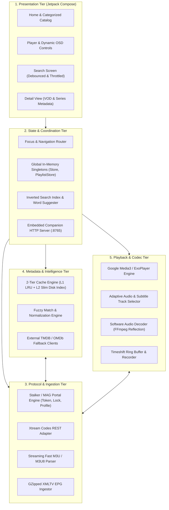
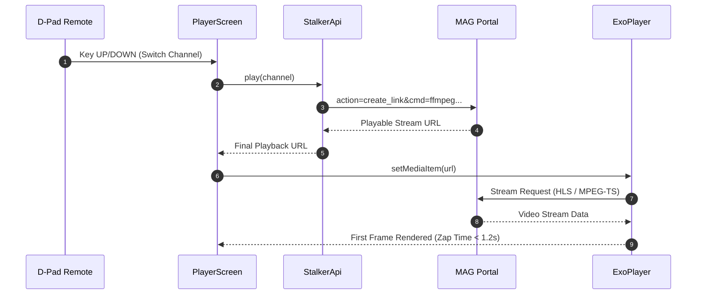

# INFINITY ONE: System Design & High-Level Design (HLD)

This document provides a comprehensive technical overview of the system architecture, component boundaries, data pipelines, and design trade-offs of **INFINITY ONE** — a native IPTV client engineered for Android TV, Google TV, Android tablets, and mobile devices.

---

## 1. System Context & Requirements

### 1.1 Operating Environment & Constraints
- **Zero Centralized Backend**: The client communicates directly with user-supplied streaming servers (Xtream Codes API, Ministra/Stalker MAG portals, M3U/M3U8 playlists, XMLTV EPG endpoints).
- **Edge Embedded Hardware**:
  - Target Devices: Fire TV Stick, Google TV Chromecast, Android TV set-top boxes.
  - Resource Bounds: $1.0\text{ GB} - 2.0\text{ GB}$ system RAM, low-power quad-core ARM SoCs, limited GPU bandwidth.
- **Latency Budgets**:
  - Channel switching: $< 1.2\text{ s}$ to initial video render.
  - UI Framerate: Constant $60\text{ fps}$ ($\le 16.6\text{ ms}$ frame budget) under rapid remote navigation.

---

## 2. High-Level Architecture

The system uses a unidirectional, data-driven architecture divided into five core tiers:

---

## 3. Component Deep Dive

### 3.1 Protocol Ingestion Engines
1. **Stalker/Ministra MAG Protocol**:
   - Implements authentication handshakes (`type=stb&action=handshake`), device profile verification (`get_profile`), and token-authenticated stream link creation (`type=itv/vod&action=create_link`).
   - Serializes concurrent HTTP operations through a thread-safe `ReentrantLock` (`callLock`) to prevent server bans.
   - Supports priority request preemption (`yieldToUrgent()`) so channel changes preempt long-running background catalog syncs.

2. **Xtream Codes Protocol**:
   - Interfaces with `player_api.php` endpoints for category trees, VOD movie streams, and series episode structures.
   - Manages live stream token appending and automatic 404 session recovery.

3. **M3U / Streaming Tokenizer**:
   - Performs streaming line-by-line parsing of massive playlists ($100{,}000+$ items) without loading full files into memory, keeping heap allocation minimal.

---

### 3.2 Media & Playback Subsystem
- **ExoPlayer Configuration**:
  - Buffer bounds: $\text{minBuffer} = 15\text{ s}$, $\text{maxBuffer} = 50\text{ s}$, $\text{playbackBuffer} = 1.5\text{ s}$.
  - Custom `HttpDataSource` with custom player User-Agents (`VLC/3.0.18`, standard MAG stbapp) to prevent server stream rejection.
- **Software Codec Reflection (`SoftAudio`)**:
  - Dynamically loads `androidx.media3.decoder.ffmpeg.FfmpegAudioRenderer` to support AC3/EAC3/DTS audio streams on hardware missing proprietary codec licenses.

---

### 3.3 Metadata & Caching Architecture
- **L1 In-Memory Cache**: LRU map holding 400 complete `Meta` objects.
- **L2 Disk Cache (`_slim.idx`)**: Compact tab-delimited JSON index for instant access to cover URLs, years, and ratings across entire catalogs.
- **Safe Matching Logic**: Eliminates blind first-item fallbacks to guarantee posters and synopsis details match queried titles.

---

## 4. End-to-End Sequence Workflows

### 4.1 Channel Zapping Workflow

